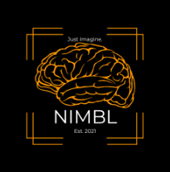

<p align="center">
  
</p>

# Motor Overflow

This repository holds a touchscreen experiment that studies **motor overflow**:
muscle activity that appears when a person is not deliberately using that muscle.
Here, it is measured while people move, watch a movement, or imagine one.

The experiment was built by the Neuroplasticity, Imagery, and Motor Behaviour
Laboratory (NIMBL). The lab studies how people learn and relearn movement,
including through watching and imagining, with the goal of improving recovery
after brain injury such as stroke. NIMBL is funded by the Natural Sciences and
Engineering Research Council of Canada (NSERC) and the Canadian Foundation for
Innovation (CFI).

> **The hand videos are not included.** To run the action-observation condition, you
> need to add your own. See [Add the videos](#add-the-videos).

## What happens in the experiment

Participants tap back and forth between an X and a target on a touchscreen, in time
with a 40 beats-per-minute metronome. They do this in four conditions:

| Condition | What the participant does |
| --- | --- |
| Motor execution (ME) | Really makes the movement |
| Action observation (AO) | Watches a video of a hand making the movement |
| Kinaesthetic motor imagery (KMI) | Imagines how the movement would feel |
| Visual motor imagery (VMI) | Imagines how the movement would look |

ME always comes first. The order of the other three changes with the participant
number, so that order doesn't favour any one condition. Each condition has four
blocks of 8 trials, and each block uses one target size, small or large.

Throughout, sensors on each hand record muscle activity (EMG) on a second computer.
The task sends time stamps to that computer, so each trial can be matched to its
muscle recording afterwards.

## Terms

| Term | Meaning |
| --- | --- |
| EMG (electromyography) | Recording the small electrical signals muscles produce |
| Spike2 | Software that records the EMG signals |
| CED Micro1401 | The hardware unit that feeds signals into Spike2 |
| BBTK USB TTL module | A Black Box ToolKit device that lets the task computer send on/off electrical pulses |
| Marker (or trigger) | A time stamp in a recording, made by one of those pulses |
| FDI (first dorsal interosseous) | The hand muscle between the thumb and index finger, recorded on each hand |
| COM port | The name Windows gives a serial connection to a device, such as `COM3` |
| MIQ-3 | Movement Imagery Questionnaire: how easily someone can imagine movements |
| MAAS | Mindful Attention Awareness Scale: how attentive someone was during a condition |
| NASA-TLX | NASA Task Load Index: how demanding a task felt |

## What's in here

| Location | What it is |
| --- | --- |
| `motor_overflow9.py` | The full experiment. **This is the file you run.** |
| `motor_execution.py` | A short version with only the ME condition and no marker hardware. |
| `bbtk_trigger.py` | Sends markers through the BBTK module. The experiment needs this file. |
| `trigger_test.py` | Sends test markers without running the experiment. |
| `media/` | The bell sound and the logo. Your hand videos go here too. |
| `spike2/` | The Spike2 recording configuration, a script that labels the markers, and a script that exports recordings to MATLAB. |
| `files/` | The guides listed below. |

### Guides

- [Setup guide](files/SETUP_INSTRUCTIONS.md): the full walk-through, from installation
  and cabling to running a session and labelling the data.
- [Cheat sheet](files/CHEAT_SHEET.md): a quick reference for commands and file names.
- [Py-Spike2 Trigger](files/Py-Spike2%20Trigger.docx) (Word document): how to add the
  same marker setup to your own Python or PsychoPy experiment.

## Try it

You can try the task without any recording equipment, on a Windows computer with
[Python](https://www.python.org/downloads/) installed. Touch handling talks to
Windows directly, so the task only runs on Windows.

In Command Prompt:

```
git clone https://github.com/NIMBL-UBC/motor_overflow.git
cd motor_overflow
py -m pip install pygame-ce pyserial opencv-python
set MO_TRIGGER_MOCK=1
py motor_overflow9.py
```

`MO_TRIGGER_MOCK=1` replaces the marker hardware with a simulated one, and the first
screen shows **MOCK MODE** in red. Until you add the videos, each AO trial shows
**Video Not Found** with a **Skip Trial** button.

To collect real recordings, add the videos below and follow the
[setup guide](files/SETUP_INSTRUCTIONS.md).

## Add the videos

The AO condition needs eight videos of a hand doing the tapping task. They are not
included in this repository, so you need to record your own.

**1. Record a video for every combination** of these three things:

| Part of the name | Options | Meaning |
| --- | --- | --- |
| Hand model | `a`, `b` | Two different people's hands. Each block shows each person equally often. |
| Hand | `rh`, `lh` | Right or left hand. The task plays the set matching the hand the participant uses. |
| Target size | `small`, `large` | The distance being tapped, matching the block's target size. |

**2. Name each file exactly as follows,** in lowercase:

```
ao_video_a_rh_small.mp4    ao_video_b_rh_small.mp4
ao_video_a_rh_large.mp4    ao_video_b_rh_large.mp4
ao_video_a_lh_small.mp4    ao_video_b_lh_small.mp4
ao_video_a_lh_large.mp4    ao_video_b_lh_large.mp4
```

**3. Put all eight files in the `media` folder.** The task finds them automatically,
so you don't need to change any code.

**What each video should look like:**

- **Length:** at least 15 seconds. The task plays the first 15 seconds of each video.
  A shorter video freezes on its last frame until the trial ends.
- **Timing:** tapping in time with a 40 beats-per-minute metronome, starting on the
  first frame. The task starts its own metronome on that frame.
- **Sound:** not needed, as the task does not play video audio.
- **Format:** the original videos were MP4, 1920 × 1080, at 30 frames per second.
  Other sizes are scaled to fit the screen without stretching, and black bars around
  the picture are cropped automatically.

Get consent from the people you film before sharing the videos, and keep them out of
any public copy of this repository. The included `.gitignore` already excludes them.

## What the task saves

The task writes each participant's responses to CSV files, which open in any
spreadsheet program. It creates these folders beside `motor_overflow9.py`:

| Folder | Contents |
| --- | --- |
| `mo_initialization` | Participant details |
| `mo_calibration` | Reach calibration results |
| `mo_session` | Condition and block order |
| `mo_task` | Trial-by-trial touch logs, and the Spike2 file each trial belongs in |
| `mo_questionnaire` | Questionnaire answers |

These folders are excluded from this repository because they hold participant data.
